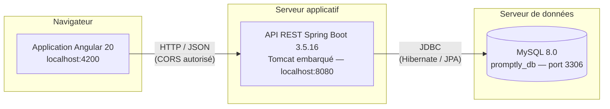
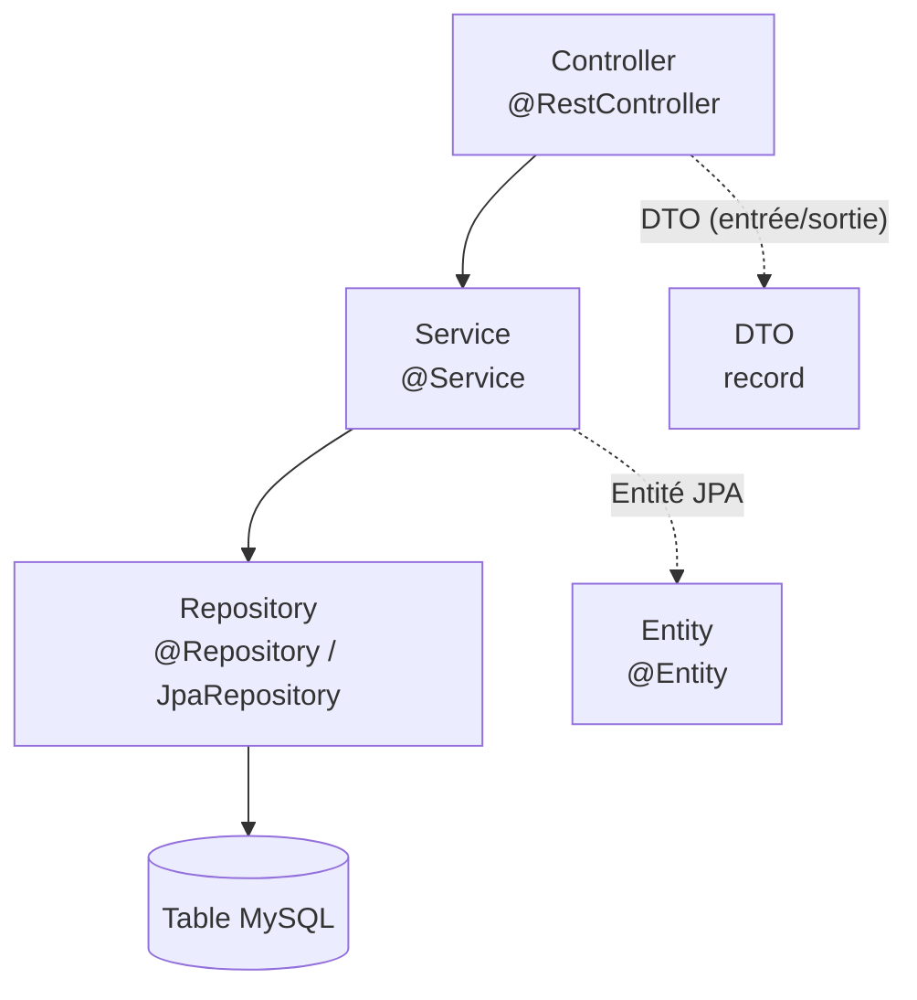
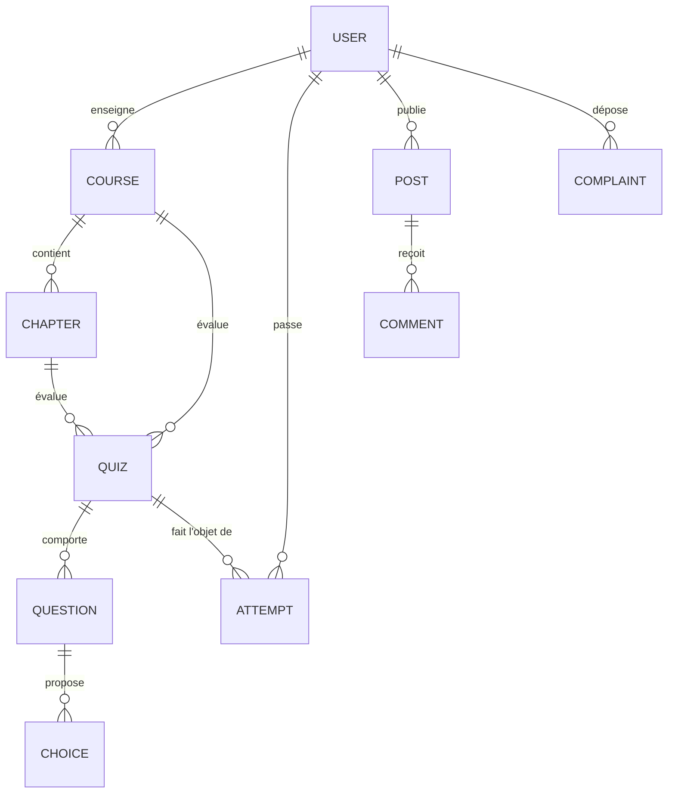

# 2. Architecture et conception

## 2.1 Architecture générale

Promptly repose sur une architecture **client-serveur découplée** en trois
couches physiques : une application cliente Angular, une API REST Spring Boot et
une base de données relationnelle MySQL.



*Figure 2.1 — Architecture générale de la plateforme Promptly.*

Le découplage entre le client et le serveur présente trois avantages :

- **indépendance technologique** : le frontend peut être remplacé (application
  mobile, par exemple) sans modifier le backend, le contrat REST restant le
  même ;
- **séparation des responsabilités** : la logique métier est centralisée côté
  serveur, où elle ne peut pas être contournée par l'utilisateur ;
- **déploiement séparé** : les deux applications peuvent évoluer et être
  déployées indépendamment.

## 2.2 Responsabilités des couches

| Couche | Responsabilités | Ne doit pas |
|--------|-----------------|-------------|
| **Frontend Angular** | Affichage, navigation, saisie et validation de confort, appels HTTP | Contenir des règles métier, accéder directement à la base |
| **API REST** | Définir le contrat d'échange (URL, méthodes HTTP, format JSON, codes de statut) | Exposer la structure interne des entités |
| **Backend Spring Boot** | Règles métier, validation stricte, autorisation, transactions, persistance | Produire du HTML ou gérer la présentation |
| **MySQL** | Persistance durable, intégrité référentielle, contraintes d'unicité | Contenir de la logique applicative (procédures stockées) |

Un point mérite d'être souligné : la validation est effectuée **des deux côtés**,
mais pour des raisons différentes. Côté Angular, elle améliore l'expérience
utilisateur en signalant immédiatement les erreurs de saisie. Côté Spring Boot,
elle constitue la seule protection réelle, car un client malveillant peut
toujours contourner le navigateur et appeler l'API directement (avec Postman,
par exemple).

## 2.3 Architecture interne du backend

Le backend est organisé **par fonctionnalité** (*package by feature*) et non par
couche technique. Chaque module métier possédera son propre paquetage contenant
l'ensemble de ses classes.

```
com.promptly.backend
├── PromptlyApplication.java      # Point d'entrée (@SpringBootApplication)
├── config/                       # Configuration transverse
│   └── CorsConfig.java           #   → autorisation des origines
├── health/                       # Module de vérification (phase 0)
│   ├── HealthController.java     #   → exposition REST
│   └── HealthResponse.java       #   → objet de transfert (record)
│
└── (à venir, un paquetage par module)
    ├── user/                     # Phase 1
    ├── course/                   # Phase 2
    ├── chapter/                  # Phase 3
    ├── quiz/                     # Phase 4
    ├── forum/                    # Phase 5
    ├── complaint/                # Phase 6
    └── ai/                       # Phase 7
```

*Figure 2.2 — Organisation des paquetages du backend.*

**Justification de ce choix.** L'organisation alternative, par couche technique
(`controllers/`, `services/`, `repositories/`, `entities/`), regroupe des classes
sans rapport fonctionnel : le contrôleur des cours se trouve à côté de celui du
forum, loin du service qu'il utilise. Avec sept modules prévus, cela produirait
des dossiers volumineux et une navigation pénible. L'organisation par
fonctionnalité maintient au contraire la cohésion : tout ce qui concerne les
cours est au même endroit, et un module peut être lu, testé ou retiré de manière
autonome.

À l'intérieur de chaque module, la séparation en couches est néanmoins
respectée :



*Figure 2.3 — Couches internes d'un module métier.*

| Composant | Rôle |
|-----------|------|
| `Controller` | Reçoit la requête HTTP, valide le format, délègue, renvoie le code de statut |
| `Service` | Applique les règles métier, orchestre les appels, gère les transactions |
| `Repository` | Accède aux données ; Spring Data génère l'implémentation |
| `Entity` | Classe Java correspondant à une table |
| `DTO` | Objet d'échange avec le client, distinct de l'entité |

L'usage de DTO distincts des entités évite d'exposer la structure interne de la
base dans l'API et de divulguer involontairement des champs sensibles (un mot de
passe haché, par exemple).

## 2.4 Architecture interne du frontend

```
src/
├── app/
│   ├── core/                     # Éléments transverses, instanciés une fois
│   │   ├── models/               #   → interfaces TypeScript
│   │   │   └── health.model.ts
│   │   └── services/             #   → accès HTTP à l'API
│   │       └── health.service.ts
│   ├── shared/                   # Éléments réutilisables dans plusieurs pages
│   │   └── components/
│   │       ├── navbar/
│   │       └── footer/
│   ├── features/                 # Une page = un dossier
│   │   └── home/
│   ├── app.ts                    # Composant racine (mise en page)
│   ├── app.routes.ts             # Table de routage
│   └── app.config.ts             # Fournisseurs (routeur, HttpClient)
├── environments/                 # URL de l'API selon l'environnement
└── styles.css                    # Styles globaux et variables CSS
```

*Figure 2.4 — Organisation des dossiers du frontend.*

La distinction `core` / `shared` / `features` est une convention courante dans
les projets Angular : `core` contient les services applicatifs uniques (accès
HTTP, authentification à venir), `shared` les composants d'interface réutilisés,
et `features` les pages métier.

Les composants créés suivent la convention de nommage introduite par Angular 20,
dans laquelle le suffixe `.component` a été supprimé (`home.ts` et non
`home.component.ts`).

## 2.5 Communication entre le frontend et le backend

### 2.5.1 Le problème de l'origine croisée (CORS)

En développement, les deux applications s'exécutent sur des ports différents :
`localhost:4200` pour Angular, `localhost:8080` pour Spring Boot. Du point de
vue du navigateur, il s'agit de **deux origines distinctes**. La politique de
sécurité *same-origin* bloque alors par défaut les requêtes de l'une vers
l'autre.

La solution retenue consiste à autoriser explicitement l'origine du frontend
côté serveur, dans la classe `CorsConfig` :

```java
registry.addMapping("/api/**")
        .allowedOrigins(allowedOrigins)
        .allowedMethods("GET", "POST", "PUT", "PATCH", "DELETE", "OPTIONS")
        .allowedHeaders("*")
        .allowCredentials(true)
        .maxAge(3600);
```

La liste des origines autorisées n'est pas écrite en dur dans le code : elle est
lue depuis la propriété `promptly.cors.allowed-origins`, ce qui permet de
l'adapter au déploiement sans recompiler l'application.

### 2.5.2 Configuration de l'URL côté Angular

Symétriquement, l'URL de l'API n'est pas écrite en dur dans les composants. Elle
est déclarée dans les fichiers d'environnement et consommée par les services :

| Fichier | Contexte d'utilisation | Valeur de `apiBaseUrl` |
|---------|------------------------|------------------------|
| `environment.development.ts` | `ng serve` (développement) | `http://localhost:8080/api` |
| `environment.ts` | `ng build` (production) | `/api` |

Angular substitue automatiquement le fichier selon la configuration de
compilation, grâce au mécanisme `fileReplacements` de `angular.json`.

## 2.6 Choix techniques et justifications

### 2.6.1 Spring Boot 3.5.16

| Critère | Analyse |
|---------|---------|
| Compatibilité Java | Spring Boot 3.x exige Java 17 au minimum, version installée sur le poste de développement |
| Gestion des versions | Le parent `spring-boot-starter-parent` fournit une nomenclature (*BOM*) garantissant la compatibilité des dépendances entre elles |
| Intégration de l'IA | Spring AI, utilisé en phase 7 pour dialoguer avec Ollama, est stabilisé sur la ligne 3.5 |
| Documentation | La documentation et les ressources pédagogiques disponibles portent majoritairement sur Spring Boot 3.x |

Spring Initializr propose désormais par défaut Spring Boot 4.x. Cette version
n'a **pas** été retenue : le support de Spring AI y est encore en version
*milestone*, ce qui exposerait le projet à des changements d'API en cours de
développement. Le fichier `pom.xml` a donc été rédigé manuellement avec la
version 3.5.16, et le *wrapper* Maven ajouté par la commande
`mvn -N wrapper:wrapper`.

### 2.6.2 Angular 20

L'environnement de développement comportait initialement Angular CLI 18 et
Node.js 24.13.1. La commande `ng version` signalait explicitement une
incompatibilité :

```
Angular CLI: 18.2.21
Node: 24.13.1 (Unsupported)
```

Angular 18 ne prend en charge que Node.js 18, 20 et 22. Deux options étaient
possibles : rétrograder Node.js vers la version 22, ou mettre à niveau Angular
CLI vers la version 20, qui prend en charge Node.js 24. La seconde a été retenue
car elle évite de maintenir plusieurs versions de Node.js sur le poste et donne
accès aux apports récents du framework (API de signaux stabilisée, nouvelle
syntaxe de contrôle de flux `@if` / `@for` dans les gabarits).

### 2.6.3 Dépendances du backend en phase 0

| Dépendance | Justification |
|------------|---------------|
| `spring-boot-starter-web` | Serveur Tomcat embarqué et contrôleurs REST |
| `spring-boot-starter-data-jpa` | Hibernate et repositories Spring Data |
| `spring-boot-starter-validation` | Bean Validation, nécessaire dès le premier module métier |
| `mysql-connector-j` | Pilote JDBC, portée `runtime` car inutile à la compilation |
| `spring-boot-devtools` | Redémarrage automatique du serveur lors d'une modification |
| `spring-boot-starter-test` | JUnit 5, Mockito, MockMvc, AssertJ |

**Spring Security n'a volontairement pas été ajouté en phase 0.** Sa simple
présence dans le `pom.xml` active une protection automatique de toutes les
routes : l'endpoint `/api/health` renverrait alors une page de connexion, ce qui
empêcherait la vérification du template. Cette dépendance sera introduite lors
du module d'authentification, en même temps que sa configuration.

### 2.6.4 Stratégie de génération du schéma de base de données

La propriété `spring.jpa.hibernate.ddl-auto` est fixée à `update` : Hibernate
crée et met à jour automatiquement les tables à partir des entités Java. Ce mode
accélère le développement, puisqu'aucun script SQL n'est à écrire manuellement.

Ses limites doivent toutefois être rappelées : Hibernate n'effectue jamais de
suppression de colonne, les modifications ne sont pas versionnées et le résultat
dépend de l'historique de la base. Dans un contexte de production, il
conviendrait d'utiliser `validate` associé à un outil de migration tel que
Flyway ou Liquibase.

## 2.7 Gestion des données sensibles

Aucun identifiant n'est écrit dans le code source ni versionné. Le fichier
`application.properties` lit les valeurs depuis des variables d'environnement :

```properties
spring.datasource.username=${PROMPTLY_DB_USER:root}
spring.datasource.password=${PROMPTLY_DB_PASSWORD:}
```

La syntaxe `${VARIABLE:valeur_par_défaut}` fournit une valeur de repli lorsque la
variable n'est pas définie. Le mot de passe réel n'apparaît donc nulle part dans
le dépôt Git, ce qui est indispensable puisque celui-ci est hébergé sur GitHub :
un secret présent dans un *commit* demeure accessible dans l'historique même
après suppression.

Les variables sont définies une seule fois au niveau de l'utilisateur Windows :

```powershell
[Environment]::SetEnvironmentVariable('PROMPTLY_DB_USER','root','User')
[Environment]::SetEnvironmentVariable('PROMPTLY_DB_PASSWORD','<mot_de_passe>','User')
```

Le fichier `.gitignore` exclut par ailleurs `application-local.properties`,
`.env` et les fichiers de clés, afin de prévenir toute fuite accidentelle.

## 2.8 Contrat de l'API — phase 0

| Méthode | URL | Corps de la requête | Réponse | Code |
|---------|-----|---------------------|---------|------|
| `GET` | `/api/health` | — | `HealthResponse` | `200 OK` |

Structure de `HealthResponse` :

| Champ | Type | Description |
|-------|------|-------------|
| `status` | `String` | État de l'API (`UP`) |
| `application` | `String` | Nom de l'application |
| `version` | `String` | Version de l'application |
| `database` | `String` | `UP`, ou `DOWN: <message>` si MySQL est injoignable |
| `timestamp` | `Instant` | Date et heure de la vérification (ISO 8601, UTC) |

Exemple de réponse effectivement obtenue :

```json
{
  "status": "UP",
  "application": "Promptly",
  "version": "0.0.1-SNAPSHOT",
  "database": "UP",
  "timestamp": "2026-10-15T18:36:04.019838500Z"
}
```

Le choix d'un `record` Java 17 pour ce type de réponse est volontaire : il
s'agit d'un porteur de données immuable, pour lequel le compilateur génère
constructeur, accesseurs, `equals()`, `hashCode()` et `toString()`. Le code s'en
trouve réduit et l'immuabilité est garantie.

Un point de conception mérite d'être relevé : l'endpoint renvoie `200 OK` **même
lorsque la base de données est inaccessible**, seul le champ `database` passant à
`DOWN`. Ce comportement est délibéré et facilite le diagnostic, puisqu'il permet
de distinguer une panne du serveur applicatif d'une panne de la base de données.

## 2.9 Conception de la base de données

En phase 0, la base `promptly_db` est **créée mais vide** : aucune entité JPA
n'ayant été définie, Hibernate n'a généré aucune table. Le modèle de données sera
construit progressivement, module par module. Le schéma conceptuel prévisionnel
est le suivant :



*Figure 2.5 — Schéma conceptuel prévisionnel. **Aucune de ces tables n'existe à
ce stade** ; ce schéma constitue une orientation de conception susceptible
d'évoluer lors de l'analyse détaillée de chaque module.*
