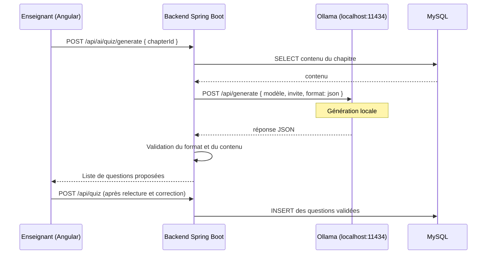

# 4. Intégration de l'IA dans l'application

## 4.1 Objet du chapitre

Ce chapitre documente l'**IA en tant que composant du logiciel livré** : une
fonctionnalité de Promptly reposant sur un modèle de langage, utilisable par
l'utilisateur final.

Il se distingue du chapitre 3, qui traite de l'IA employée comme outil de
production du code. Les deux sujets sont indépendants : l'IA de développement
n'apparaît pas dans l'application, et l'IA intégrée n'intervient pas dans la
génération du code.

## 4.2 État d'avancement

> **AUCUNE INTÉGRATION D'IA N'EST RÉALISÉE À CE JOUR.**
>
> La phase 0 est strictement limitée à la fondation technique. Ce chapitre
> présente l'**étude préalable des options** et ne rapporte aucun résultat
> d'exécution, aucune mesure ni aucune capture d'écran, puisque rien n'a encore
> été installé ni testé.

| Élément | État |
|---------|------|
| Choix de la fonctionnalité | Non arbitré |
| Choix de la technologie (Ollama ou API externe) | Non arbitré |
| Installation | Non effectuée |
| Implémentation | Non effectuée |
| Tests | Non effectués |

Ce chapitre sera complété lors de la phase 7, après validation des modules
métier dont la fonctionnalité d'IA dépend.

## 4.3 Fonctionnalités envisageables

Quatre fonctionnalités ont été identifiées comme pertinentes pour une plateforme
d'apprentissage de la programmation. Elles sont présentées à titre d'étude ;
aucune n'est retenue à ce stade.

### Option A — Génération automatique de questions de quiz

**Principe.** À partir du contenu textuel d'un chapitre, le modèle produit des
questions à choix multiples avec leurs propositions de réponses et l'indication
de la réponse correcte. L'enseignant relit, corrige et valide avant publication.

| Critère | Analyse |
|---------|---------|
| Intérêt pédagogique | Élevé : la rédaction manuelle de QCM est la tâche la plus répétitive pour un enseignant |
| Dépendance | Nécessite les modules Chapitres (3) et Quiz (4) |
| Complexité technique | Moyenne : exige une réponse en JSON structuré et sa validation |
| Risque | Questions hors sujet ou réponse correcte erronée → **validation humaine obligatoire** |
| Démonstrabilité | Très bonne : le résultat est immédiatement visible et vérifiable |

### Option B — Explication de concepts de programmation

**Principe.** L'étudiant soumet une notion (« qu'est-ce que l'injection de
dépendances ? ») et reçoit une explication adaptée à son niveau, avec un exemple
de code.

| Critère | Analyse |
|---------|---------|
| Intérêt pédagogique | Moyen à élevé, mais recouvre partiellement l'usage direct d'un assistant généraliste |
| Dépendance | Aucune : implémentable indépendamment des modules métier |
| Complexité technique | Faible : une seule requête, réponse en texte libre |
| Risque | Explications inexactes non détectables par un étudiant débutant |
| Démonstrabilité | Bonne |

### Option C — Assistant de correction de code

**Principe.** L'étudiant soumet un extrait de code ; le modèle identifie les
erreurs et suggère des améliorations.

| Critère | Analyse |
|---------|---------|
| Intérêt pédagogique | Élevé |
| Dépendance | Aucune |
| Complexité technique | Élevée : nécessite un modèle spécialisé en code et une gestion de contextes longs |
| Risque | Corrections erronées ; risque pédagogique de substitution à l'apprentissage |
| Démonstrabilité | Moyenne : les résultats sont difficiles à évaluer objectivement |

### Option D — Résumé automatique de discussions du forum

**Principe.** Synthèse des fils de discussion longs du forum.

| Critère | Analyse |
|---------|---------|
| Intérêt pédagogique | Faible |
| Dépendance | Nécessite le module Forum (5) et un volume de données réel |
| Complexité technique | Moyenne |
| Démonstrabilité | Faible : exige un jeu de données conséquent pour être convaincante |

### Recommandation

**L'option A (génération de questions de quiz) est recommandée**, pour quatre
raisons :

1. elle répond à un besoin propre à la plateforme, qu'un assistant généraliste
   externe ne couvre pas ;
2. elle impose un **format de sortie structuré** (JSON), dont la validation
   constitue une démonstration technique plus riche qu'un simple échange textuel ;
3. elle intègre naturellement une **validation humaine**, ce qui permet de
   traiter la question de la fiabilité des modèles de langage ;
4. son résultat est directement observable, donc facile à illustrer par des
   captures d'écran.

L'option B pourrait la compléter à moindre coût si le temps disponible le permet.

## 4.4 Comparaison des technologies

### 4.4.1 Ollama — modèle de langage exécuté localement

Ollama est un logiciel permettant d'exécuter des modèles de langage sur la
machine locale et exposant une API HTTP (par défaut `http://localhost:11434`).

| Avantages | Inconvénients |
|-----------|---------------|
| Gratuit, sans limite d'usage | Consommation importante de mémoire vive (8 Go recommandés pour un modèle de 7 milliards de paramètres) |
| Aucune donnée transmise à un tiers | Qualité inférieure à celle des grands modèles commerciaux |
| Aucune clé d'API à gérer ni à protéger | Latence dépendante du matériel ; nettement plus lente sans carte graphique dédiée |
| Fonctionne hors connexion | Installation requise sur la machine de démonstration |
| Démontre une compétence d'intégration locale, appréciée en contexte académique | Difficilement déployable sur un hébergement mutualisé |

### 4.4.2 API externe

| Avantages | Inconvénients |
|-----------|---------------|
| Qualité de génération supérieure | Coût par requête |
| Aucune contrainte matérielle locale | Nécessite une clé d'API, à protéger impérativement |
| Latence faible et prévisible | Les données sont transmises à un tiers |
| Mise en œuvre rapide | Dépendance à la connexion réseau et aux quotas d'usage |

### 4.4.3 Recommandation technologique

**Ollama est recommandé comme solution principale**, pour les motifs suivants :

- absence de coût, contrainte déterminante dans un projet étudiant ;
- absence de secret à gérer, donc aucun risque de fuite de clé dans le dépôt
  Git ;
- la démonstration d'une intégration locale présente un intérêt pédagogique
  supérieur à l'appel d'une API commerciale ;
- la génération de QCM est une tâche de difficulté modérée, à la portée d'un
  modèle de taille moyenne.

**Prérequis à vérifier avant tout engagement :** la quantité de mémoire vive
disponible sur le poste de développement. Ce point n'a pas encore été contrôlé.

Si les ressources matérielles se révèlent insuffisantes, une API externe
constituera la solution de repli, la clé étant alors stockée dans une variable
d'environnement selon le mécanisme déjà mis en place pour le mot de passe MySQL
(voir section 2.7).

## 4.5 Architecture d'intégration envisagée

Dans l'hypothèse où Ollama serait retenu :

*Figure 4.1 — Séquence d'intégration envisagée. **Architecture prévisionnelle,
non implémentée.***

Deux principes de conception sont d'ores et déjà retenus :

1. **Le frontend n'appelle jamais Ollama directement.** Tous les échanges
   transitent par le backend, ce qui centralise la validation, la gestion des
   erreurs et l'autorisation.
2. **Aucun contenu généré n'est enregistré sans validation humaine.** Les
   questions produites sont soumises à l'enseignant, qui les corrige avant
   publication. Cette contrainte répond directement au risque d'inexactitude des
   modèles de langage.

## 4.6 Points à documenter lors de la réalisation

Liste de contrôle établie par anticipation, à compléter en phase 7 :

- [ ] Justification du choix final (Ollama ou API externe), au vu des ressources
      matérielles effectivement disponibles
- [ ] Modèle retenu, nombre de paramètres, taille sur disque, et motifs du choix
- [ ] Étapes d'installation et de configuration réellement suivies
- [ ] Commandes d'exécution du modèle et sortie observée
- [ ] Mécanisme de communication entre Spring Boot et le modèle (client HTTP ou
      Spring AI)
- [ ] Format exact des requêtes et des réponses
- [ ] Extraits du service backend et de sa configuration
- [ ] Exemples réels d'entrées et de sorties
- [ ] Gestion des erreurs, des délais d'attente et des limites constatées
- [ ] Mesures de latence effectivement relevées
- [ ] Tests automatisés de l'intégration
- [ ] Captures d'écran du modèle en exécution et du résultat dans Promptly
- [ ] Analyse critique de la qualité des contenus générés

## 4.7 Décision attendue

Aucune implémentation ne sera entreprise avant arbitrage explicite sur :

1. la fonctionnalité à développer (options A, B, C ou D) ;
2. la technologie à employer (Ollama ou API externe) ;
3. le moment d'intervention dans le calendrier (phase 7, ou plus tôt si la
   fonctionnalité choisie ne dépend pas des modules métier).
